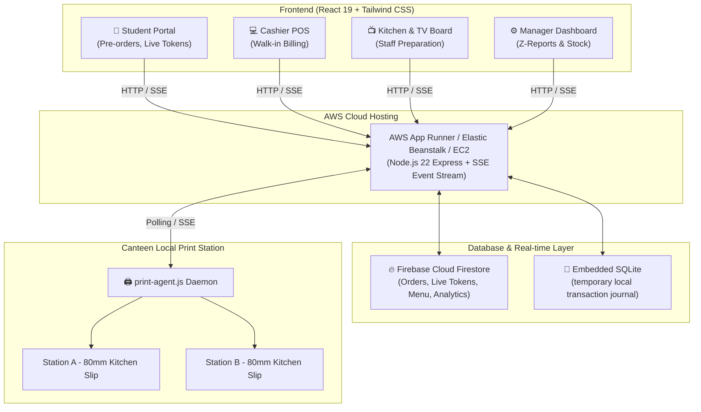

# 🚀 AWS Deployment & Firebase Setup Guide

## Canteen Queue Reduction & Dual-Printer Express System

---

## 📌 Architecture Overview



---

## 🔥 Part 1: Firebase Cloud Database Setup (2 Minutes)

The application features automatic hybrid synchronization with **Firebase Firestore**:

### Step 1: Create a Firebase Project
1. Go to [Firebase Console](https://console.firebase.google.com/) and click **Add project**.
2. Name it (e.g., `canteen-express-campus`).
3. Click **Firestore Database** in the left sidebar $\rightarrow$ click **Create database** $\rightarrow$ choose your nearest region (e.g., `asia-south1 (Mumbai)` for India).
4. Select **Production Mode** and hit Enable.

### Step 2: Get Service Account Credentials
1. In Firebase Console, go to **Project Settings** (gear icon) $\rightarrow$ **Service accounts**.
2. Click **Generate new private key** $\rightarrow$ click **Generate key**.
3. Download the JSON file and rename it to:
   ```
   serviceAccountKey.json
   ```
4. Place `serviceAccountKey.json` inside the `server/` directory:
   ```
   canteen-queue-system/server/serviceAccountKey.json
   ```
5. *Or* in AWS environment variables, set:
   - `FIREBASE_PROJECT_ID` = your Firebase project ID
   - `FIREBASE_CLIENT_EMAIL` = client email from JSON
   - `FIREBASE_PRIVATE_KEY` = private key from JSON

---

## ☁️ Part 2: Deploying to AWS with Docker (recommended)

Build the React client first, then use the repository `Dockerfile` to run the
Express API on port `5000`. Firebase credentials must be
configured as AWS secrets/environment variables; they are not copied into the
image.

### AWS App Runner

1. Build the client and push this repository to GitHub, or build and push the image to Amazon ECR:
   `npm --prefix client ci && npm --prefix client run build`
2. In **AWS App Runner**, choose **Create service** and select the repository
   (or ECR image). Use the repository `Dockerfile`.
3. Set the container port to `5000` and health check path to `/health`.
4. Add these environment variables (use App Runner Secrets Manager references
   for the three credential values):
   `NODE_ENV=production`, `PORT=5000`, `REQUIRE_FIREBASE=true`,
   `FIREBASE_PROJECT_ID`, `FIREBASE_CLIENT_EMAIL`, and `FIREBASE_PRIVATE_KEY`.
5. Deploy. Verify the generated HTTPS URL at `/health`; its `firebase.connected`
   value must be `true`.

### Build and push to ECR

```powershell
aws ecr create-repository --repository-name canteen-queue-system --region ap-south-1
aws ecr get-login-password --region ap-south-1 | docker login --username AWS --password-stdin <account-id>.dkr.ecr.ap-south-1.amazonaws.com
docker build -t canteen-queue-system .
docker tag canteen-queue-system:latest <account-id>.dkr.ecr.ap-south-1.amazonaws.com/canteen-queue-system:latest
docker push <account-id>.dkr.ecr.ap-south-1.amazonaws.com/canteen-queue-system:latest
```

Do not pass `FIREBASE_PRIVATE_KEY` on a command line or commit it to source
control. Store it in AWS Secrets Manager and inject it into App Runner or ECS.

## ☁️ Part 3: Other AWS deployment options

Choose the method that fits your infrastructure:

### 🌟 Method 1: AWS App Runner (Fastest & Zero Server Maintenance)

AWS App Runner automatically builds and runs your container with automatic HTTPS/TLS, load balancing, and zero OS maintenance.

1. **Push code to GitHub** (or AWS ECR).
2. Open the **AWS App Runner Console** $\rightarrow$ click **Create service**.
3. Source:
   - Select **Source code repository** (connect your GitHub repo).
   - Branch: `main`.
4. Build settings:
   - Choose **Use a configuration file** (uses our root `Dockerfile`), OR:
   - Runtime: `Node.js 20/22`.
   - Build command:
     ```bash
     cd client && npm install && npm run build && cd ../server && npm install
     ```
   - Start command:
     ```bash
     node server/src/server.js
     ```
   - Port: `5000`.
5. Environment Variables:
   - Add `NODE_ENV` = `production`
   - Add `PORT` = `5000`
   - (Optional) Add your Firebase credentials.
6. Click **Create & Deploy**. In ~3 minutes, AWS will provide a live HTTPS URL (e.g. `https://xyz.awsapprunner.com`).

---

### 📦 Method 2: AWS Elastic Beanstalk (Node.js PaaS)

1. Build the React client:
   ```powershell
   cd client
   npm run build
   ```
2. Initialize EB CLI in the project:
   ```powershell
   cd ../server
   eb init -p node.js-20 canteen-express --region ap-south-1
   eb create canteen-prod-env
   ```
3. Set environment variables:
   ```powershell
   eb setenv PORT=5000 NODE_ENV=production
   ```
4. Open your live app:
   ```powershell
   eb open
   ```

---

### 🖥️ Method 3: AWS EC2 (Free Tier eligible - t4g.small / t3.micro)

For complete control using Amazon Linux 2023 or Ubuntu:

#### 1. Launch Instance
- AMI: **Amazon Linux 2023** or **Ubuntu 24.04 LTS**.
- Instance Type: `t3.micro` or `t4g.small` (Free tier eligible).
- Security Group: Allow Inbound Ports `22` (SSH), `80` (HTTP), `443` (HTTPS), and `5000` (Direct test).

#### 2. SSH into your EC2 Instance
```bash
ssh -i your-key.pem ec2-user@your-ec2-ip
```

#### 3. Install Node.js 22 & Git
```bash
sudo dnf update -y
sudo dnf install -y git
curl -fsSL https://rpm.nodesource.com/setup_22.x | sudo bash -
sudo dnf install -y nodejs
sudo npm install -g pm2
```

#### 4. Clone & Build
```bash
git clone <your-repo-url> canteen-system
cd canteen-system

# Build Client
cd client
npm ci
npm run build

# Setup Server
cd ../server
npm ci --only=production
```

#### 5. Start with PM2 (Auto-restart on reboot)
```bash
pm2 start src/server.js --name "canteen-express"
pm2 startup
pm2 save
```

#### 6. Setup Nginx Reverse Proxy (Optional, Port 80 $\rightarrow$ 5000)
```bash
sudo dnf install -y nginx
sudo systemctl enable nginx
sudo systemctl start nginx
```

Add reverse proxy configuration in `/etc/nginx/conf.d/canteen.conf`:
```nginx
server {
    listen 80;
    server_name your-domain-or-ip;

    location / {
        proxy_pass http://127.0.0.1:5000;
        proxy_http_version 1.1;
        proxy_set_header Upgrade $http_upgrade;
        proxy_set_header Connection 'upgrade';
        proxy_set_header Host $host;
        proxy_cache_bypass $http_upgrade;
        
        # Enable Server-Sent Events (SSE) streaming
        proxy_buffering off;
        proxy_read_timeout 86400s;
    }
}
```
Reload Nginx:
```bash
sudo nginx -s reload
```

---

## 🖨️ Part 3: Connecting the Local Physical Printer Spooler

Because thermal receipt printers are connected to a physical POS machine via USB or LAN inside the college canteen:

1. On the canteen's physical PC (Windows/Linux/Mac), download or clone `print-agent.js`.
2. Configure `SERVER_URL` in `print-agent.js`:
   ```javascript
   const SERVER_URL = 'https://your-aws-apprunner-url.awsapprunner.com';
   ```
3. Run the print agent:
   ```powershell
   node print-agent.js
   ```
4. The local agent will poll your AWS server, pull queued orders assigned to `PRINTER_1` and `PRINTER_2`, and print them onto the physical thermal slips with 0 latency.

---

## 🔒 Part 4: Role-Based Access Reference

| Role | Default PIN | Permitted Views | Blocked Views |
|---|---|---|---|
| **Student** | Any ID (e.g. `21BCS001`) | **Student Portal Only** (Order menu, active token, claim verification) | ❌ **Kitchen & TV Board**, ❌ Cashier POS, ❌ Printer Monitor, ❌ Z-Report, ❌ Menu Editor |
| **Cashier** | `1234` | Cashier POS Counter, Kitchen & TV Board | ❌ Printer Spooler Config, ❌ Z-Report Audit |
| **Kitchen Staff** | `5555` | Kitchen & TV Preparation Board | ❌ Student Portal, ❌ Cashier POS |
| **Admin / Manager** | `9999` | **Full Master Access** (All tabs, live stock toggle, printer spools, daily Z-report audit) | None |
